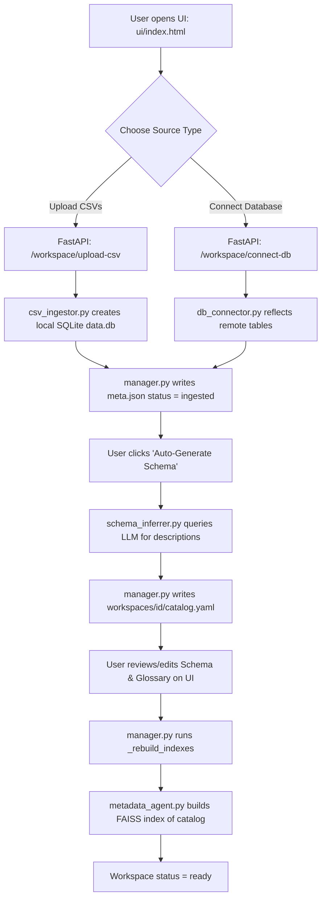
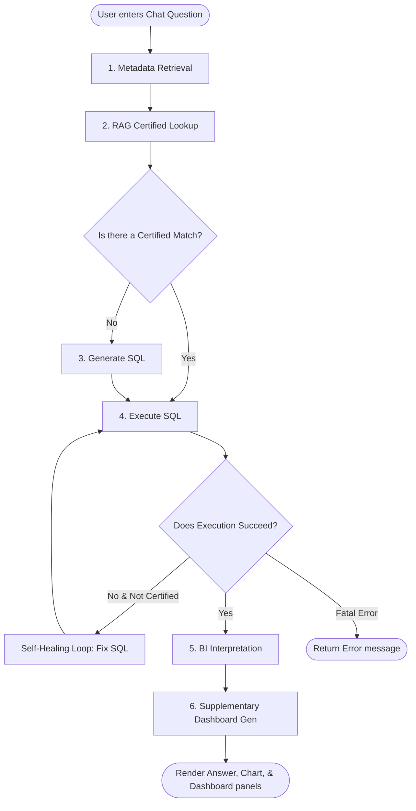
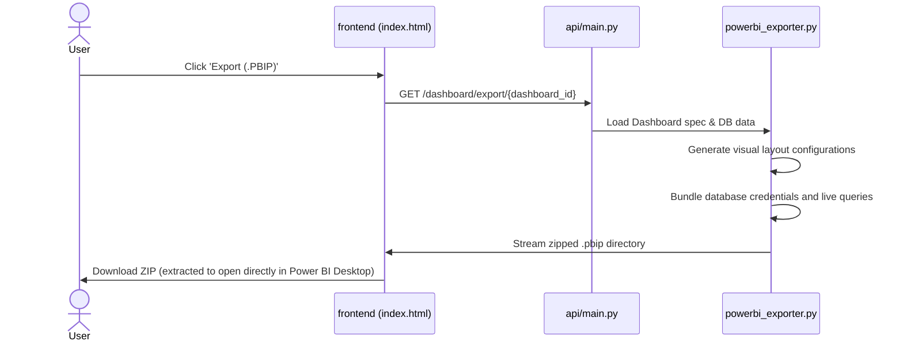

# GenBI POC: Architectural Flow & Execution Guide

This document provides a comprehensive, manager-friendly explanation of the **GenBI (Generative Business Intelligence)** Proof of Concept (POC). It breaks down the directory structure, file execution hierarchy, and the end-to-end workflows that enable natural language querying of data, self-healing SQL generation, and dynamic dashboard creation.

---

## 1. Directory Structure & File Execution Order

Before looking at the runtime workflows, here is the hierarchy of files and folders in the project, ordered by how they are loaded and executed when running the platform.

### A. Initialization & Server Boot
*   **`.env`**: Contains environment configurations (e.g., LLM api keys, SQLite/external DB configurations, server ports). Loaded first.
*   **[api/main.py](file:///c:/Users/snair/OneDrive/Desktop/test-poc/api/main.py)**: The entrypoint of the FastAPI backend. Initiates the server and manages the startup lifecycle.
*   **[api/workspace_routes.py](file:///c:/Users/snair/OneDrive/Desktop/test-poc/api/workspace_routes.py)**: Loaded by `main.py` at boot time to define all workspace onboarding and management APIs (e.g., uploading data, schema generation, glossary setup).
*   **[watch_workspace.py](file:///c:/Users/snair/OneDrive/Desktop/test-poc/watch_workspace.py)**: Spawned as a background subprocess by `main.py` during lifespan startup. It monitors workspace files for offline asynchronous requests (useful when using agent-specific file pipelines like `ag_chat`).

### B. Onboarding & Data Preparation Phase
*   **[workspace/manager.py](file:///c:/Users/snair/OneDrive/Desktop/test-poc/workspace/manager.py)**: Coordinates data lifecycles on the backend. When API endpoints are hit, it handles database ingestion, runs inference, and writes configuration files.
*   **[workspace/csv_ingestor.py](file:///c:/Users/snair/OneDrive/Desktop/test-poc/workspace/csv_ingestor.py)**: Executed when a user uploads CSV datasets. Ingests raw data rows and creates a structured, local SQLite database (`data.db`).
*   **[workspace/db_connector.py](file:///c:/Users/snair/OneDrive/Desktop/test-poc/workspace/db_connector.py)**: Executed when a user connects to an external database (e.g., Postgres, MySQL). Reflects schemas and establishes connection strings.
*   **[workspace/schema_inferrer.py](file:///c:/Users/snair/OneDrive/Desktop/test-poc/workspace/schema_inferrer.py)**: Executed when the user requests "Auto-Schema" generation. Translates raw table structures to user-friendly column descriptions using the LLM.
*   **[workspace/glossary_generator.py](file:///c:/Users/snair/OneDrive/Desktop/test-poc/workspace/glossary_generator.py)**: Executed during the glossary draft generation phase. Learns business terminology mappings based on the schema catalog.

### C. Runtime Query & Orchestration Phase
*   **[agents/orchestrator.py](file:///c:/Users/snair/OneDrive/Desktop/test-poc/agents/orchestrator.py)**: Evaluates incoming user questions (`/ask`). Instantiates the LangGraph pipeline and collects outputs.
*   **[agents/graph.py](file:///c:/Users/snair/OneDrive/Desktop/test-poc/agents/graph.py)**: Builds the execution state graph (**LangGraph**) linking various sub-agents together using conditional edges and routing logic.
*   **[agents/llm_client.py](file:///c:/Users/snair/OneDrive/Desktop/test-poc/agents/llm_client.py)**: Provides a unified interface to initialize LLM clients (Gemini, OpenRouter, or local Ollama) with thread-safe caching.
*   **[agents/metadata_agent.py](file:///c:/Users/snair/OneDrive/Desktop/test-poc/agents/metadata_agent.py)**: Executed at the start of a query. Retrieves the most semantically relevant tables, column descriptions, and glossary terms using a local FAISS vector index.
*   **[agents/rag_agent.py](file:///c:/Users/snair/OneDrive/Desktop/test-poc/agents/rag_agent.py)**: Executed alongside metadata context. Checks a FAISS index of "certified reports" (hand-written verified SQL queries) to see if a pre-existing query matches the user's intent.
*   **[agents/sql_agent.py](file:///c:/Users/snair/OneDrive/Desktop/test-poc/agents/sql_agent.py)**: Executed if no certified report is found. Prompts the LLM to write a database-specific SQL query. Also performs *self-healing* if database execution errors out.
*   **[agents/execute_agent.py](file:///c:/Users/snair/OneDrive/Desktop/test-poc/agents/execute_agent.py)**: Runs the generated SQL against the SQLite or external database and returns structured table rows.
*   **[agents/bi_agent.py](file:///c:/Users/snair/OneDrive/Desktop/test-poc/agents/bi_agent.py)**: Interprets raw database outputs. Generates a natural language narrative and designs a structured chart specification (visual instructions for charts).
*   **[agents/dashboard_agent.py](file:///c:/Users/snair/OneDrive/Desktop/test-poc/agents/dashboard_agent.py)**: Generates additional related panels/visuals to form a dashboard layout alongside the primary answer.

### D. Exporting Phase
*   **[agents/powerbi_exporter.py](file:///c:/Users/snair/OneDrive/Desktop/test-poc/agents/powerbi_exporter.py)**: Executed when the user clicks "Export". Packages generated visuals into a native Power BI Developer Project (`.pbip`) or template format.

---

## 2. Detailed Workflows: How it Works End-to-End

### Workflow A: The Onboarding Flow (Data Ingest & Schema Setup)

This flow initializes a workspace and constructs the metadata layer so the AI can understand what questions can be asked.

#### Steps:
1.  **Ingestion**: Raw data is converted into a standard relational database structure (SQLite `data.db` for uploaded CSVs, or a direct connector for databases).
2.  **AI Metadata Enrichment**: The AI reads the bare table and column names and auto-generates descriptive text explaining what each column means and how tables relate (joins). This is saved in `catalog.yaml`.
3.  **Human-in-the-Loop Review**: The user has full control to refine, add, or correct these descriptions and map common business terms (e.g. mapping "revenue" to the `grand_total` column).
4.  **Vector Store Compilation**: The app converts these written definitions into numeric embeddings and indexes them using **FAISS**. This makes it lightning-fast for the LLM to search for the right database context later.

---

### Workflow B: The Conversational Query Flow (`/ask`)

When a user asks a question in the chat interface, the query goes through a multi-agent LangGraph pipeline:

#### Detailed Agent Roles:
1.  **Semantic Context Filtering (Metadata Agent)**:
    Instead of passing the entire database schema to the LLM (which is slow and expensive), the Metadata Agent searches the FAISS index. It retrieves only the tables, columns, and business terms relevant to the user's question, and appends the recent conversation history.
2.  **Certified Reports Lookup (RAG Agent)**:
    Checks if an administrator has previously uploaded a verified, hand-written SQL query for this exact kind of question (saved in `certified_reports.yaml`). If matched, it uses that exact SQL, eliminating AI hallucination.
3.  **SQL Writing (SQL Agent)**:
    If no certified query exists, the SQL Agent combines the semantic context with the user's question and instructs the LLM to write a database-compliant query.
4.  **Database Execution & Self-Healing (Execute Agent & SQL Agent)**:
    The Execute Agent runs the query. If the database rejects the query (e.g. syntax error or missing table alias), the SQL Agent intercepts the error, explains the failure back to the LLM, and asks it to correct the query. It retries automatically.
5.  **Data Narrative & Visual Spec (BI Agent)**:
    Once raw database rows are obtained, the BI Agent writes a summary response in conversational language and constructs a JSON chart specification (e.g., `{"chart_type": "bar", "x_key": "date", "y_key": "sales"}`).
6.  **Contextual Dashboard Generation (Dashboard Agent)**:
    Behind the scenes, the Dashboard Agent suggests 2–4 related analytical angles, runs auxiliary queries, and outputs a micro-dashboard to give the user broader business context.

---

### Workflow C: Exporting to Power BI

To bridge the gap between AI chat and enterprise reporting, the platform can generate developer-friendly reporting packages.

#### Steps:
1.  **Spec Extraction**: The Power BI exporter loads the active chat session's dashboard configuration and data results.
2.  **Visual Layout Translation**: It translates the AI-generated chart specifications into native Power BI visual models.
3.  **Data Connection Hookup**: It embeds Power Query M code pointing back to the FastAPI `/dashboard/data/` live endpoint, allowing the report to refresh with live data.
4.  **Packaging**: Bundles these into a standard `.pbip` (Power BI Project) structure, zipped, and downloads to the user's system so it can be opened directly.
